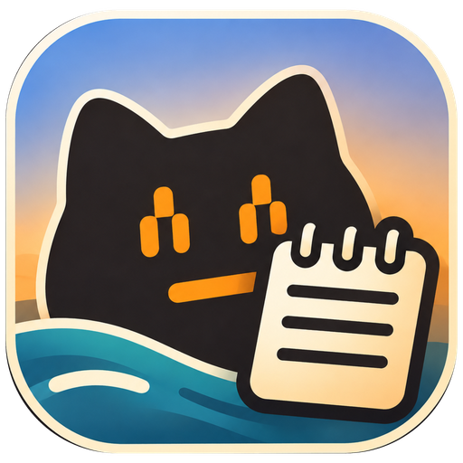

<p align="center">
  
</p>

# bbb-notepad

<p align="center">
  <strong>A better Notepad for my own needs.</strong><br>
  A local desktop app for the notes, ideas, values, and prompts I use each day.
</p>
<p align="center">
  <a href="CHANGELOG.md">Version 0.2.1-beta (unreleased)</a> ·
  <a href="docs/development/validation.md">Windows x64 validated</a>
</p>

---

[First-note tutorial](docs/getting-started/first-note.md) ·
[Getting started](#quick-start)

**Contents** · [What I need from Notepad](#what-i-need-from-notepad) · [Capabilities](#what-you-can-do) · [Installation](#installation) ·
[Quick start](#quick-start) · [Architecture](#architecture) ·
[Documentation](#documentation)

## What I need from Notepad

Notepad is where I put quick notes. The problems start when I need to find
an old note, group related content, or add behavior for the way I work.

- **Search across notes.** Find saved text without remembering its file or keeping its tab open.
- **Group related content.** Keep environment values, ideas, and scripts in named blocks that I can style and collapse.
- **Reuse selected text.** Collect sentences and blocks into a prompt without copying each part separately.
- **Extend the editor.** Add features for my own workflow as my needs change.

bbb-notepad keeps quick capture at the center, with automatic saving and
search across open and closed notes. Pairs provide structure within a note.
Extensibility currently means changes to the app's source code.

## What you can do

- **Capture and find notes.** Use tabs, automatic saving, and search across open and closed notes.
- **Format text.** Use optional live Markdown, highlighted code, and Mermaid diagrams.
- **Organize values and ideas.** Use styled `ENV`, `IDEA`, and `SCRIPT` pairs with masking and collapsible blocks.
- **Copy prompts.** Collect sentences and blocks for copying.
- **Work with files.** Import and export text files.
- **Adjust the editor.** Select a light or dark theme, change editor zoom, and use keyboard shortcuts.

This is an independent personal project. Quick capture is the implemented mode.
Other modes and a notes CLI are not implemented. Startup and large-collection
performance have not yet been benchmarked. See [validation limits](docs/development/validation.md#remaining-limits).

## Installation

### Windows beta

If you have the Windows beta installer, run
`bbb-notepad_<version>_x64-setup.exe`. Then open **bbb-notepad**.
Download published installers from [GitHub Releases](https://github.com/BeepBoopBit/bbb-notepad/releases). The upcoming `0.2.1-beta` has not been released yet.
To build an installer locally, follow [Releasing](RELEASING.md).

| Target | Status |
| --- | --- |
| Windows x64 | Desktop app and per-user installer validated |
| macOS and Linux | Intended desktop targets; native builds and installers still need validation |
| Browser | Development preview with separate browser storage |
| Public releases and update feed | Not published or configured yet |

The app supports manual signed updates with a backup before installation.
This requires a configured release feed. See [Releasing](RELEASING.md).

### Local development

From the project root, with Node.js 24 and npm installed:

```sh
npm ci
npm run dev
```

Open `http://localhost:1420`. Stop the server with Ctrl+C when finished.
Preview data stays in that browser origin's localStorage.
The preview does not open the desktop database.

For desktop development, install a stable Rust toolchain and the native
prerequisites in the [development guide](docs/development/README.md).
Then run:

```sh
npm run tauri -- dev
```

## Quick start

With **bbb-notepad** open:

1. Press Ctrl+T to create a note.
2. Type an idea.
3. Wait for **All changes saved**.
4. Press Ctrl+W to close its tab.
5. Press Ctrl+K to open search.
6. Search for a word from the idea.
7. Press Enter to reopen the note.

Closing a tab keeps the note in search.
Follow the [first-note tutorial](docs/getting-started/first-note.md) to check
restoration after an app restart.
If a step fails, use [troubleshooting](docs/guides/troubleshooting.md).

## Architecture

The React editor uses Tauri commands to read and save desktop notes through
Rust and SQLite. The browser preview uses separate localStorage.
Presentation preferences are stored separately from desktop notes.

See the [architecture guide](docs/architecture/README.md) for component
boundaries, save behavior, rendering, and updates.

### Data and privacy

Desktop notes are stored locally in SQLite.
`ENV` masking hides a value on screen. It does not encrypt the stored text.
Source copying and file export can include actual values.
Read [data and backups](docs/guides/data-and-backups.md) before you use a note
as the only copy of important information.

## Documentation

| I want to… | Guide |
| --- | --- |
| Save and reopen a first note | [First-note tutorial](docs/getting-started/first-note.md) |
| Capture, close, and find notes | [Capture and search](docs/guides/capture-and-search.md) |
| Use Markdown, pairs, and folding | [Markdown and pairs](docs/guides/markdown-and-pairs.md) |
| Collect text for a prompt | [Copy prompts](docs/guides/copy-prompts.md) |
| Open or export a text file | [Files](docs/guides/files.md) |
| Find data or restore a backup | [Data and backups](docs/guides/data-and-backups.md) |
| Look up shortcuts or editor limits | [Shortcuts](docs/reference/shortcuts.md) · [Editor reference](docs/reference/editor.md) |
| Build or test the app | [Development](docs/development/README.md) · [Validation](docs/development/validation.md) |
| Diagnose a problem | [Troubleshooting](docs/guides/troubleshooting.md) |
| Review changes or prepare a release | [Changelog](CHANGELOG.md) · [Releasing](RELEASING.md) |

## AI-assisted development

AI tools have been used during development.
Contributors remain responsible for reviewing changes and identifying
third-party sources. See [Contributing](CONTRIBUTING.md).

## Updates and contributions

Updates follow my needs as I use the app. There is no fixed release schedule.
If you need a feature or find a bug, open an issue and describe the problem.
You can also fork the project, make the change, and submit a pull request.
Feature requests and pull requests do not guarantee an update or acceptance.

See [Contributing](CONTRIBUTING.md) for setup and checks.

## License

This project is licensed under the [MIT License](LICENSE).
Dependencies retain their applicable licenses.

---

[All documentation](docs/README.md) · [Contributing](CONTRIBUTING.md) ·
[Changelog](CHANGELOG.md) · [Releasing](RELEASING.md) · [MIT License](LICENSE)
