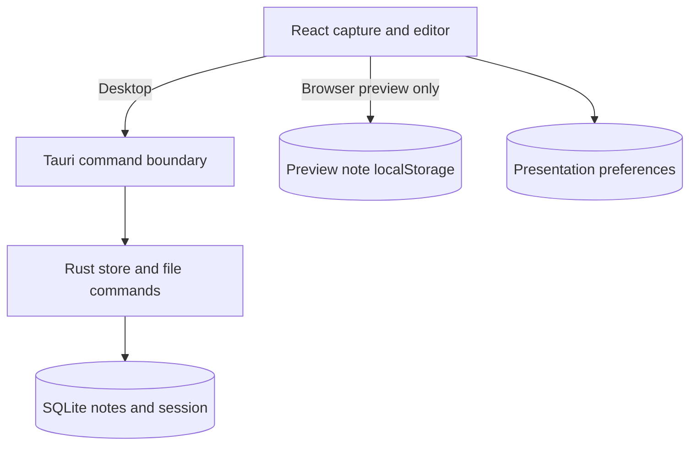

# Runtime and storage boundaries

The desktop app and browser preview share the UI but store notes separately.

## State ownership

Text alternative: desktop note operations cross the Tauri boundary to Rust and SQLite. Browser preview note operations stay in browser localStorage. Themes and other presentation preferences are separate from the note database.

## Save and search behavior

The React app tracks unsaved note revisions and serializes saves. It removes a dirty revision only after its exact write succeeds. A 200 ms timer schedules saving; normal desktop closure flushes before destroying the window. Failed writes remain retryable.

SQLite stores note text, update timestamps, pair indexes, and the open-tab session. WAL mode and full synchronization protect completed database writes, not unsaved UI changes. Closing a tab retains its note. Search uses literal substring matching, not the maintained FTS5 index.

The desktop store is scoped by `dev.bbb.notes`, preserving data across the name change. Multiple launches focus the existing desktop instance. The app does not implement synchronization, a background tray, a global capture hotkey, or a notes CLI.

## Editing and rendering

Ordinary capture starts with a textarea. Markdown, pairs, or suggestions load CodeMirror on demand. Rendering is virtualized; code language support and Mermaid load lazily. Pair presentation remains active independently of Markdown presentation.

Stored text remains the source of truth. Folding, rendered selection, and transient editor positions do not replace the saved source. Current-session positions and folds are not restored across app restarts.

## Files and updates

Desktop file dialogs and file access run through Rust commands. An import creates a new note; an export writes source without linking future edits to the file.

Manual updates use the native updater. The download is verified before the app locks editing, flushes writes, and creates a SQLite backup. A failed save or backup aborts installation. The installer handles replacement and restart. The local beta has no configured feed; release-channel limitations are in [Releasing](../../RELEASING.md#update-channels).

## Owning sources

| Boundary | Sources and checks |
| --- | --- |
| UI lifecycle and save queue | [App](../../src/app/App.tsx), [capture tests](../../tests/capture.spec.ts) |
| Desktop command and store | [Commands](../../src-tauri/src/lib.rs), [SQLite store and tests](../../src-tauri/src/store.rs) |
| Browser adapter | [Storage](../../src/notes/storage.ts), [storage tests](../../src/notes/storage.test.ts) |
| Rendering and navigation | [Editor](../../src/editor/MarkdownEditor.tsx), [renderer](../../src/editor/markdown/markdown-render.ts), [editor reference](../reference/editor.md) |
| Update boundary | [Service](../../src/updates/updates.ts), [dialog](../../src/updates/UpdateDialog.tsx), [bridge tests](../../tests/updates.spec.ts) |

Use [development checks](../development/README.md#run-focused-checks) for implementation work. See [checks and limits](../development/validation.md) for test coverage.

## Source folders

`src/main.tsx` starts React. `src/app/` owns the application component, window controls, and application styles.

`src/editor/` owns CodeMirror integration. Its `markdown/`, `pairs/`, and `copy/` folders group related editor code. `src/notes/` owns note storage, note IDs, and pair parsing used outside the editor.

`src/files/`, `src/settings/`, and `src/updates/` each contain the UI and services for that function. `src/platform/` owns desktop detection and clipboard access. `src/ui/` contains shared icons. `src/types/` contains external type declarations.

Unit tests stay beside their source files. Browser tests and shared fixtures stay in `tests/`. Rust source stays in `src-tauri/src/`.
