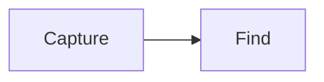

# Edit Markdown and pairs

Use optional Markdown presentation and always-visible pairs to organize a note while keeping its stored text editable.

## Turn Markdown on or off

Click **Render Markdown** in the action row. With rendering enabled, headings, emphasis, lists, tables, code, and diagrams display in place. The active Markdown block exposes its editable source.

Choose **View → Word Wrap** to toggle line wrapping in either editor. The preference is remembered across restarts.

Turning Markdown off leaves ordinary Markdown syntax literal. Pairs still display their styles, disclosure arrows, and ENV masking. The toggle does not turn pairs off.

Write checklist items as `- [ ] Task` or `- [x] Done` (`*` also works as the list marker). Rendered checklists show larger checkboxes without a bullet beside them. Edit the source to change their checked state.

Plain text starts in a lightweight editor. Markdown, pairs, or pair suggestions load the richer editor on demand. The first transition cannot carry over the initial textarea's undo history. Subsequent toggle changes retain the richer editor for that session.

## Insert a pair

Type `!` at the start of a line. Choose ENV, IDEA, or SCRIPT with the arrow keys and press Enter. ENV inserts a scalar value; IDEA and SCRIPT insert braces with the cursor inside.

```text
!ENV: EXAMPLE_TOKEN=replace-this-example
!IDEA:{
Make the introduction shorter.
---
End with a concrete next step.
}
!SCRIPT:{
Welcome everyone.
Today we will explain the idea.
}
```

Add an optional name in parentheses to replace the displayed type label: `!ENV(API token): value`, `!IDEA(Next steps): text`, or `!SCRIPT(Introduction):{` followed by its body and closing brace. Names can contain spaces and Unicode, but not parentheses or line breaks. The type still controls masking, styling, and `pair:ENV` / `pair:SCRIPT` searches. Empty names use the type label.

These are synthetic values. An ENV row shows eight bullets and an eye button. Revealing or editing its value exposes the actual text. Masking is a display feature, not encryption.

Click a pair value to edit inside its existing styling. Use **Edit** to expose the full pair syntax, including its key and braces. Custom keys and nested block pairs are supported; see [pair syntax](../reference/editor.md#pairs).

## Insert a line break

Outside styled callouts, Enter and Shift+Enter both insert one newline. The editor does not add Markdown hard-break spaces or list indentation.

Inside an IDEA or SCRIPT value, Enter moves outside the block. Shift+Enter inserts a newline inside it. When the pair is exposed through **Edit**, Enter keeps ordinary source-editing behavior.

Insert a blank line yourself to start a separate Markdown paragraph. Pasted text is preserved rather than rewritten on load.

## Fold a section

Click a heading's disclosure arrow to fold its section. A pair's arrow folds its value. Expanded pairs accept arrow-key navigation inside; collapsed pairs are skipped.

Type `/collapse` or `/expand` on its own line and press Enter to fold or unfold the current note. In the rich editor, `/` opens a command menu. Commands are consumed rather than saved as note text. Running one from the initial plain-text editor also enables Markdown presentation. Commands inside fenced code remain literal.

Folding survives tab switches within a running session. It does not alter stored text. Cross-restart folding state is not promised.

## Add code or a diagram

Use a fenced block with a language name for highlighted code. Use `mermaid` for diagrams:

````markdown

````

Code languages and Mermaid load on demand. Large or invalid blocks keep an editable fallback. Rendering limits and supported syntax are listed in the [editor reference](../reference/editor.md#markdown-presentation).
